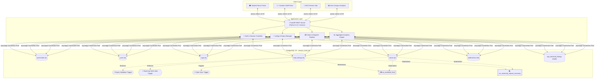

# 🍲 FoodBridge: Inter-University Surplus Food Waste Redistribution System

[](https://www.postgresql.org/)
[](https://fastapi.tiangolo.com/)
[](https://developer.mozilla.org/)
[]()
[]()

---

## 📖 Project Overview

**FoodBridge** is an inter-university leftover food waste management and NGO redistribution platform developed for an academic **Database Management Systems (DBMS)** capstone project. 

In major university hubs like **Bengaluru**, significant quantities of high-quality, freshly prepared food are wasted daily across student messes, hostel canteens, and university events. Simultaneously, registered non-profit organizations (NGOs) and food banks struggle with timely surplus discovery and routing.

FoodBridge establishes a **real-time, auditable, and transaction-safe bridge** between academic campus food providers and verified hunger-relief organizations, powered by **PostgreSQL 18** and **FastAPI**.

---

## 🏛️ System Architecture



---

## 🗄️ Relational Database Schema Design

The system implements 3rd Normal Form (3NF) relational design across **7 tables**, with foreign keys, custom ENUM types, multi-column indexes, and triggers.

| Table Name | Primary Key | Foreign Keys / Key Constraints | Purpose |
| :--- | :--- | :--- | :--- |
| `universities` | `university_id` | Unique: `short_code`, `contact_email` | Participating university campuses in Bengaluru (`NIT-B`, `BCU`, `RVCE`, `PESU`). |
| `users` | `user_id` | `university_id` &rarr; `universities` | Donors and staff (`student`, `canteen_staff`, `campus_admin`). |
| `ngos` | `ngo_id` | Unique: `registration_number`, `email` | Registered relief organizations with operating radius and verified status. |
| `food_listings` | `listing_id` | `university_id`, `donor_id` | Surplus food postings with portion count, prep time, expiry time, and status. |
| `claims` | `claim_id` | `listing_id` (UNIQUE 1:1), `ngo_id` | Food rescue claims with ETA, volunteer contact, and collection lifecycle. |
| `notifications` | `notification_id`| `ngo_id`, `user_id` | Real-time notifications dispatched automatically by database triggers. |
| `ngo_declined_listings` | `id` | `ngo_id`, `listing_id` (UNIQUE composite) | Audit trail of listings declined by specific NGOs to avoid duplicate alerts. |

### Database Views
1. **`vw_available_food`**: Real-time filtered view of fresh food batches that have not expired (`expiry_time > CURRENT_TIMESTAMP`) and are currently `available`. Computes dynamic `minutes_remaining`.
2. **`vw_university_impact_summary`**: Aggregates university donations, total servings rescued, active listings, and computes total $CO_2$ emissions averted.

### Triggers & Business Logic
- **`trg_check_listing_expiry_before_claim`**: Invokes `fn_before_claim_insert()` to reject claims on food batches whose `expiry_time` has already passed.
- **`trg_notify_ngos_on_new_listing`**: Invokes `fn_after_listing_insert()` to generate real-time rows in `notifications` for all verified NGOs within the operational city.
- **`trg_sync_listing_status_on_claim`**: Automatically transitions `food_listings.status` between `'claimed'`, `'collected'`, and `'available'` on claim events.
- **Stored Procedure `sp_claim_food()`**: Demonstrates transactional concurrency with row-level locking (`SELECT ... FOR UPDATE`) to prevent race conditions during claims.

---

## 🔑 Demo Credentials (1-Click Ready)

All demo accounts use password: **`password123`**

| Role | Name | Email / ID | Campus / Affiliation | Dashboard URL |
| :--- | :--- | :--- | :--- | :--- |
| **Student Donor** | Aarav Sharma | `aarav.sharma@nit.edu` | NIT Bengaluru | [Student Portal](http://127.0.0.1:8000/student-dashboard.html) |
| **Canteen Staff** | Ramesh Babu | `ramesh.canteen@nit.edu` | NIT Bengaluru Mess | [Canteen Portal](http://127.0.0.1:8000/canteen-dashboard.html) |
| **Student Donor** | Priya Verma | `priya.v@bcu.ac.in` | Bengaluru City University | [Student Portal](http://127.0.0.1:8000/student-dashboard.html) |
| **NGO Rescuer** | Robin Hood Army | `bengaluru@robinhoodarmy.com` | RHA Bengaluru Hub | [NGO Portal](http://127.0.0.1:8000/ngo-dashboard.html) |
| **NGO Rescuer** | Feed The Need | `contact@feedtheneedblr.org` | Feed The Need Bengaluru | [NGO Portal](http://127.0.0.1:8000/ngo-dashboard.html) |
| **Public / Admin**| Cross-Campus View | *(No login required)* | All Bengaluru Campuses | [Analytics Dashboard](http://127.0.0.1:8000/analytics.html) |

> 💡 **Quick Login Tip**: On `http://127.0.0.1:8000/login.html`, click any of the **"Quick Demo Autofill" chips** to populate credentials and switch roles in one click.

---

## 🚀 Quick Setup & Launch Guide

### Option 1: 1-Click Batch Runner (Windows)
Double-click **`run_server.bat`** in the project root directory.  
It will:
1. Activate the backend directory.
2. Launch the FastAPI Uvicorn server on `http://127.0.0.1:8000`.
3. Open your default web browser directly to the FoodBridge login screen.

### Option 2: Manual Terminal Execution
```bash
# 1. Navigate to backend directory
cd backend

# 2. Start Uvicorn ASGI Server
python -m uvicorn app:app --host 127.0.0.1 --port 8000 --reload
```
Access the application at: **`http://127.0.0.1:8000`**  
Access Interactive Swagger API Docs at: **`http://127.0.0.1:8000/docs`**

---

## 🐘 pgAdmin 4 Setup (PostgreSQL 18)

1. Open **pgAdmin 4** and connect to your local PostgreSQL server (`localhost:5432`).
2. Create database named: **`campus_food_db`**.
3. Open the **Query Tool** on `campus_food_db`.
4. Open and execute [`database/postgres_schema.sql`](file:///C:/Users/Admin/.gemini/antigravity/scratch/campus-food-redistribution/database/postgres_schema.sql) (creates all tables, views, and triggers).
5. Open and execute [`database/postgres_seed_data.sql`](file:///C:/Users/Admin/.gemini/antigravity/scratch/campus-food-redistribution/database/postgres_seed_data.sql) (inserts sample campuses, users, and food batches).
6. Verify connection settings in [`backend/db.py`](file:///C:/Users/Admin/.gemini/antigravity/scratch/campus-food-redistribution/backend/db.py) (default: `postgres` / `admin`).
7. **Generate Visual ER Diagram**: In pgAdmin 4, right-click `campus_food_db` &rarr; click **Generate ERD** to display the visual entity relationship diagram.

---

## 🎯 Top DBMS Viva & Evaluation Queries

All 9 viva queries are pre-formatted for pgAdmin in [`database/postgres_queries.sql`](file:///C:/Users/Admin/.gemini/antigravity/scratch/campus-food-redistribution/database/postgres_queries.sql).

### Query 1: Active & Unexpired Surplus Food Listings
```sql
SELECT listing_id, food_title, food_category, quantity_servings,
       university_name, pickup_location, donor_name, minutes_remaining
FROM vw_available_food
ORDER BY expiry_time ASC;
```

### Query 2: Inter-University Redistribution Performance Leaderboard
```sql
SELECT 
    u.name AS campus_name,
    COUNT(f.listing_id) AS total_batches_posted,
    COALESCE(SUM(CASE WHEN f.status = 'collected' THEN f.quantity_servings ELSE 0 END), 0) AS servings_rescued,
    ROUND(
        COALESCE(SUM(CASE WHEN f.status = 'collected' THEN f.quantity_servings ELSE 0 END) * 100.0 / 
        NULLIF(SUM(f.quantity_servings), 0), 0), 1
    ) AS rescue_success_rate_pct,
    ROUND(COALESCE(SUM(CASE WHEN f.status = 'collected' THEN f.quantity_servings ELSE 0 END), 0) * 2.5, 1) AS co2_averted_kg
FROM universities u
LEFT JOIN food_listings f ON u.university_id = f.university_id
GROUP BY u.university_id, u.name
ORDER BY servings_rescued DESC;
```

### Query 3: Multi-Table 5-Way Join of Active Volunteer Rescues
```sql
SELECT 
    c.claim_id, f.food_title, f.quantity_servings, f.pickup_location,
    u.name AS campus_name, donor.full_name AS donor_name,
    ngo.name AS claiming_ngo, c.volunteer_name, c.volunteer_phone,
    c.expected_pickup_time, c.claim_status
FROM claims c
JOIN food_listings f ON c.listing_id = f.listing_id
JOIN universities u ON f.university_id = u.university_id
JOIN users donor ON f.donor_id = donor.user_id
JOIN ngos ngo ON c.ngo_id = ngo.ngo_id
WHERE c.claim_status = 'active';
```

### Query 4: Environmental Impact Formula (CO2 Mitigation)
```sql
-- Formula: 1 kg diverted food waste prevents 2.5 kg CO2 equivalent greenhouse emissions
SELECT 
    COUNT(CASE WHEN status = 'collected' THEN 1 END) AS completed_rescues,
    COALESCE(SUM(CASE WHEN status = 'collected' THEN quantity_servings ELSE 0 END), 0) AS total_kg_diverted,
    ROUND(COALESCE(SUM(CASE WHEN status = 'collected' THEN quantity_servings ELSE 0 END), 0) * 2.5, 2) AS co2_averted_kg,
    ROUND(COALESCE(SUM(CASE WHEN status = 'collected' THEN quantity_servings ELSE 0 END), 0) * 2.5 / 1000.0, 3) AS co2_metric_tons
FROM food_listings;
```

---

## 💡 Key DBMS Concepts Demonstrated

1. **Relational Integrity**: Foreign key constraints with `ON DELETE RESTRICT` and `ON UPDATE CASCADE` prevent orphaned transactions.
2. **Domain Integrity**: Custom PostgreSQL ENUM types (`user_role`, `food_category_type`, `food_status_type`) prevent invalid state assignments.
3. **Check Constraints**: `chk_expiry_after_prepared` ensures food expiry timestamps are strictly later than cooking timestamps.
4. **Trigger-Driven Atomicity**: Prevents claiming spoiled food before insertion, reducing race conditions at the database level.
5. **Concurrency Control**: Row-level locking (`SELECT ... FOR UPDATE`) in `sp_claim_food` ensures that two simultaneous claims cannot claim the same food batch.
6. **SQL Views**: Abstraction of complex multi-table joins into reusable `vw_available_food` and `vw_university_impact_summary`.
7. **Audit Logging**: `ngo_declined_listings` tracks user decision history independently from active transactional rows.

---

## 📁 Repository Directory Structure

```text
campus-food-redistribution/
├── run_server.bat                 # 1-Click launcher for server & browser
├── README.md                      # Comprehensive academic & viva evaluation guide
├── PGADMIN_SETUP.md               # Visual pgAdmin 4 connection guide
├── backend/
│   ├── app.py                     # FastAPI REST API endpoints & route handlers
│   ├── db.py                      # Database connection pool & auto-detector
│   ├── import_excel.py            # Excel batch import utility
│   ├── manage_data.py             # CLI database management & seeding tool
│   └── .env                       # Database credentials & port configuration
├── database/
│   ├── postgres_schema.sql        # PostgreSQL 18 DDL: 7 tables, views, triggers
│   ├── postgres_seed_data.sql     # Bengaluru sample data for viva demonstration
│   ├── postgres_queries.sql       # 9 Viva & evaluation SQL queries for pgAdmin
│   ├── schema.sql                 # MySQL-compatible schema alternative
│   ├── seed_data.sql              # MySQL sample data alternative
│   └── foodbridge_template.xlsx   # Sample Excel template for batch upload
└── frontend/
    ├── index.html                 # Entrypoint (auto-redirects to login)
    ├── login.html                 # Unified multi-role portal with 1-click autofill
    ├── student-dashboard.html     # Student donor portal (tiffin donation & tracking)
    ├── canteen-dashboard.html     # Canteen bulk donor portal (active + past history)
    ├── ngo-dashboard.html         # NGO rescue command center (feed, claim, pass)
    ├── analytics.html             # Cross-campus sustainability leaderboard
    ├── css/                       # Semantic, responsive CSS styles
    └── js/                        # Pure ES6 modular client-side logic
```

---

## 👥 Academic Project Information

- **Project Title**: FoodBridge - Inter-University Food Waste Management System
- **Subject**: Database Management Systems (DBMS) Laboratory / Capstone
- **DBMS Engine**: PostgreSQL 18 (pgAdmin 4 GUI)
- **Framework**: FastAPI (Python ASGI)
- **Standardized City Scope**: Bengaluru, Karnataka, India
- **Impact Formula**: $\text{CO}_2\text{ Savings (kg)} = \text{Food Waste Rescued (kg)} \times 2.5$
